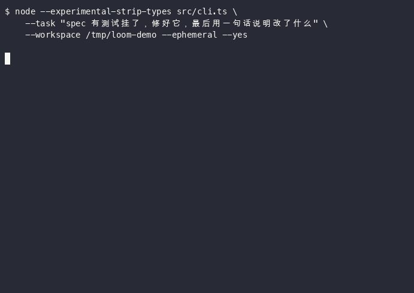

# loom

[](https://github.com/wygxxdm/Loom/actions/workflows/ci.yml)

给 AI 一句话，它自己读代码、改文件、跑测试。仓库里另外带一套对照实验，用来量出哪些机制真有用、哪些只是增加成本。



上面是真实运行，没有剪辑：一个测试挂掉的小项目，它自己找到问题在哪、把写反的两个分支改回来、重跑测试确认，六轮结束。

技术上这是一个 coding agent harness——模型通过工具调用读写文件和执行命令，harness 负责拼装这些能力，并处理上下文、权限、会话和预算。模型、工具、会话存储、权限策略都是可替换的插件，插件之间靠声明的依赖装配。

零运行时依赖，零构建步骤。

## 状态

早期版本，接口还会变。目前 68 个测试，跑在 Node 22 上。

## 要求

Node >= 22.6。项目直接用 `--experimental-strip-types` 运行 `.ts` 源码，所以不需要 `npm install`，也没有编译产物。

## 快速开始

```bash
# 不需要 API key：scripted 模型按预设步骤调用工具
node --experimental-strip-types src/cli.ts --task "看看项目结构" --model scripted

# 真实任务
export DEEPSEEK_API_KEY=sk-...
node --experimental-strip-types src/cli.ts \
  --task "修掉 src/clamp.ts 里上下界写反的问题" \
  --workspace /path/to/repo \
  --plan --yes
```

`--plan` 会先让模型产出一份结构化任务规格再执行。`--yes` 把写文件和执行命令的权限授到本次 run；不加的话会逐次询问，非 TTY 环境默认拒绝。

## 命令行

| 参数 | 说明 |
| --- | --- |
| `--task <text>` | 要执行的任务；不传则进入交互模式 |
| `--workspace <dir>` | 工作目录，默认当前目录 |
| `--model <kind>` | `deepseek` 或 `scripted`，默认按有没有 `DEEPSEEK_API_KEY` 判断 |
| `--plan` | 先规划再执行 |
| `--optimize` | 先改写需求再执行，多一次模型调用 |
| `--session <id>` | 会话 id |
| `--session-dir <dir>` | 会话目录，默认 `~/.loom/sessions` |
| `--resume` | 续跑上次因预算耗尽中断的任务 |
| `--ephemeral` | 会话只留内存，不落盘 |
| `--yes` | 自动授权写和命令执行 |
| `--max-rounds <n>` | 模型请求轮次上限，默认 32 |
| `--max-tool-calls <n>` | 工具调用数上限，默认 96 |
| `--timeout-ms <n>` | 单次运行墙钟上限，默认 480000 |
| `--quiet` | 只输出最终结果 |

## 交互模式

不带 `--task` 时进入 REPL：

| 命令 | 说明 |
| --- | --- |
| `/sessions` | 列出会话 |
| `/use <id>` | 切换会话 |
| `/new [id]` | 新建会话 |
| `/delete <id>` | 删除会话 |
| `/history [n]` | 查看最近 n 条记录 |
| `/plan [text]` | 查看当前任务规格；带文本则先规划 |
| `/context` | 上下文用量 |
| `/compact` | 立即压缩一次 |
| `/continue` | 续跑上次中断的任务 |
| `/pwd` / `/cd <path>` | 查看 / 切换工作目录，切换时新建会话 |
| `/quit` | 退出 |

## 目录

```
src/
  kernel/        容器、能力键、插件协议、依赖解析
  contracts/     端口定义，只有类型
  plugins/       各能力的实现
  runtime.ts     装配
  cli.ts         入口
test/            node:test
bench/           对照实验
```

`runtime.ts` 里没有写死的加载顺序：每个插件声明 `needs` / `provides`，`resolveOrder()` 做拓扑排序，顺带检查缺提供者、循环依赖和同一能力被重复提供。

```
events → session → session-catalog → tools → file-tools → shell-tool
       → permission → guard → model → optimizer → planning → compactor → agent-loop
```

## 实现说明

**会话和上下文是两样东西。** Session 是 append-only 的 JSONL，只追加不修改；发给模型的上下文每轮重新构建，超过阈值时压缩。压缩只影响这一次请求的投影，磁盘上的历史不动。

**一轮写一个批次。** 模型的工具调用和这轮全部工具结果合并成一次写入并 fsync，崩溃最多丢整批。载入时扫一遍没有对应结果的调用，补一条失败记录，否则续跑时消息顺序不合法，API 直接返回 400。

**token 估算会自校准。** 本地估算是 ASCII/4 + 非 ASCII×1，偏保守。运行时拿服务端返回的 `prompt_tokens` 做 EMA 修正，压缩阈值按修正后的值判断。

**摘要失败会降级。** 生成摘要的模型调用出错时，退回只裁剪不摘要，任务继续跑。

**只读工具并发。** 同一批里 `read-only` 的调用最多 4 个并发，其余按顺序执行，结果按调用顺序回填。

**重复调用有护栏。** 相同工具加相同参数在滑动窗口里第 3 次出现时，插一条提醒，同一个指纹只提醒一次。

## 权限

风险分六级，前三档自动放行：

| 等级 | 例子 | 默认 |
| --- | --- | --- |
| `read-only` | `read_file`、`list_dir` | 放行 |
| `agent-state` | `update_task` | 放行 |
| `shell-low` | `ls`、`cat`、`git status` | 放行 |
| `workspace-write` | `write_file`、`edit_file`、`delete_file` | 需要授权 |
| `shell` | `npm test`、`git push` | 需要授权 |
| `shell-high` | 含管道、重定向、命令替换的命令 | 需要授权 |

授权范围四档：`once`、`run`、`task`、`session`。预算耗尽时保留 task 级授权，`--resume` 或 `/continue` 接着跑不用重新确认。

授权键是 `tool:risk`，不包含参数。

`run_command` 走的是真 shell，管道和重定向可以用。判断风险靠一个引号感知的词法扫描：出现未加引号的 `` | & ; < > $ ` ( ) `` 就判 `shell-high`；可执行文件在只读白名单里（`ls`、`cat`、`grep`、`git status` 等）判 `shell-low`；其余判 `shell`。命令放在独立进程组里，超时用 `kill(-pid)` 整组回收。

## 工具

| 工具 | 风险 | 说明 |
| --- | --- | --- |
| `read_file` | `read-only` | 支持 offset / limit |
| `list_dir` | `read-only` | 单层，不递归 |
| `write_file` | `workspace-write` | 整文件创建或覆盖 |
| `edit_file` | `workspace-write` | 按片段精确替换 |
| `delete_file` | `workspace-write` | 软删除到 `.loom/trash/` |
| `run_command` | `shell` / `shell-low` / `shell-high` | 见上 |
| `update_task` | `agent-state` | 更新任务进度 |

`edit_file` 有三条约束：精确匹配，不做空白归一化；`old` 在文件里必须唯一，出现多次就报错，除非显式 `replaceAll`；任何校验失败都不写盘，文件保持原样。

`delete_file` 不调 unlink，把文件移到 `.loom/trash/` 并返回原路径，可以手工移回。目录和符号链接一律拒绝。这里有个细节：路径解析对父目录做 realpath 校验，对最后一段只做 `lstat`。如果用 realpath 解析末段，删一条指向 A 的符号链接会变成删掉 A。

## benchmark

```bash
node --experimental-strip-types bench/runner.ts
node --experimental-strip-types bench/runner.ts --model deepseek --repeat 3

# 先看要跑多少次、大概多少 token
node --experimental-strip-types bench/runner.ts --model deepseek --repeat 3 --dry-run

# 只跑其中一部分
node --experimental-strip-types bench/runner.ts --only fix-clamp,fix-deep-merge --arms baseline,full
```

每次运行落一个 json 到 `bench/runs/<model>/<arm>/<task>-s<seed>.json`。重跑时已经完成的会跳过并标 `cached`，加 `--force` 才重跑。

限流（429）和 5xx 会退避重试三次；其它错误直接记为失败，因为确定性失败重试只会浪费时间。

`--dry-run` 会根据已有结果的平均 token 推算剩余开销；想换算成钱就设 `LOOM_PRICE_PER_M`（元/百万 token），不设就只报 token 数——各家价格会变，写死在代码里没意义。

12 个任务，4 个臂：`baseline`、`compact`、`optimize`、`full`。

| 类别 | 任务 |
| --- | --- |
| feature | `feat-version-flag`、`feat-query-parser`、`feat-csv-export`、`feat-slug`、`feat-range` |
| bugfix | `fix-route-order`、`fix-cache-ttl`、`fix-deep-merge`、`fix-clamp`、`fix-split` |
| refactor | `refactor-extract-validator`、`refactor-split-formatter` |

### 结果

`deepseek-flash`，2 个 seed，共 96 次运行，花费约 2 元（0.66M / 0.64M / 0.95M / 0.49M token）。

| arm | pass | 中位数 token | 均值 token | 平均延迟 |
| --- | --- | --- | --- | --- |
| baseline | 24/24 | **16,147** | 27,439 | 15.6s |
| compact | 24/24 | 18,553 | 26,652 | 32.0s |
| optimize | 24/24 | 28,254 | 39,390 | 21.6s |
| full | 24/24 | 17,776 | **20,327** | 23.3s |

四臂成功率完全一样，token 差异集中在少数几道题上。三点观察：

1. **成功率没有差异。** 12 道题在这个模型上都能做完，且 1M 上下文远没到上限，所以压缩不影响正确性。
2. **中位数上 baseline 最省。** 压缩要额外调一次模型生成摘要，改写要多一次请求，短任务上回不了本——12 道题里 baseline 有 7 道是最省的。
3. **均值上 full 最省，但完全由一道题决定。** `fix-deep-merge` 两次运行 baseline 是 222k / 44k，full 是 32k / 26k。压缩压的是长尾，不是均值。

改写（`optimize`）在两个 seed 下都明显更贵，中位数是 baseline 的 1.75 倍，两个种子一致，不是噪声。让模型先重述一遍需求，它会探索更多、跑更多轮。

所以在这批任务上：**上下文机制是成本保险，不是性能优化。** 要观察到成功率差异，任务得长到接近窗口上限，或者需要大量探索。这个结论和"压缩能提升能力"的直觉相反，但它是这 96 次运行给出的。

原始结果在 `bench/results/2026-10-23/`，可以复算。

### 压力测试：把窗口压到 1500 token

系统提示加 7 个工具 schema 本身占 650 token（空会话上测的），所以 `w=1500` 时留给对话的只有约 900 token，理论上应该频繁触发压缩。

| 配置 | pass | 中位数 token | 均值 token | 压缩次数/运行 | 平均延迟 |
| --- | --- | --- | --- | --- | --- |
| 不压缩 | 12/12 | 14,656 | 34,258 | 0 | 18.0s |
| w=1500 | 12/12 | 17,310 | 23,278 | 1.0 | 24.0s |
| w=3000 | 12/12 | 28,656 | 29,269 | 1.0 | 27.9s |
| w=6000 | 12/12 | 17,896 | 24,515 | 0.2 | 20.2s |
| w=12000 | 12/12 | 18,044 | 23,705 | 0.1 | 14.0s |
| w=24000 | 12/12 | 23,629 | 24,260 | 0.0 | 14.2s |

（单 seed，12 题。）

结果比预期明确：**窗口压到 1500，成功率也没掉**，而且压缩平均只触发 1 次。原因是 8 轮左右的对话压完一次历史就重新变短，压力累积不起来。

也就是说，这批题的问题不是窗口不够小，而是**任务太短**。想测出压缩的价值，任务必须长到能持续推动历史增长，改窗口参数没用。

中位数那一列也值得看：每个压缩配置都比不压缩贵（17.3k–28.7k vs 14.7k）。均值更低只是因为 baseline 那道 22 万 token 的异常题被平均进去了。

逐窗口的原始数据在 `bench/results/2026-10-23/window-sweep/`。

每题是一个独立的小工作区，附一份 spec。agent 在副本里工作，验证之前用工作区外的原始 spec 覆盖回去，改测试不算通过。每个任务都验证过两件事：初始工作区跑 spec 必须失败，参考解打上之后必须通过。

`scripted` 模式只是流水线冒烟：模型按预设脚本执行，只有 4 个任务带 demo，其余会被跳过并列出来。跑出来的成功率没有参考价值。要看数字得用 `--model deepseek`，并且每个任务跑多次。

## 开发

```bash
npm test        # 68 个用例
npm run smoke   # 用 scripted 模型跑一遍 CLI
npm run bench   # 四臂流水线
```

CI 在 ubuntu 和 macos 上跑这三条。

## 已知限制

- 没有沙箱。命令直接在宿主机执行，风险分级和授权是唯一的闸门。要做到真正隔离得靠 Docker、`sandbox-exec` 或 seccomp。
- 子进程继承全部环境变量，包括 `DEEPSEEK_API_KEY`。
- 授权键不含参数，`allow-run` 会放大到同风险等级的其它调用。
- 单进程单会话。`childScope()` 已经实现，但 runtime 还没用起来，多会话并发会串状态。
- 摘要状态只存在内存里，续跑时会重新总结一次。
- 没有流式输出，`model.run()` 一次性返回。
- 工具参数没有做 JSON Schema 校验，类型错了会在工具内部抛出来。
- 上下文窗口上限是配置常量，没有从模型读取。
- Windows 没验证过，进程组回收依赖 POSIX 语义。
- benchmark 12 题、2 个 seed，只够看方向。试过把窗口压到 1500 token 强制触发压缩，成功率仍然打平，压缩平均只触发 1 次/运行——瓶颈是任务长度，不是窗口大小。要测出压缩对成功率的影响，得造能跑几十轮的长任务。

## License

MIT
